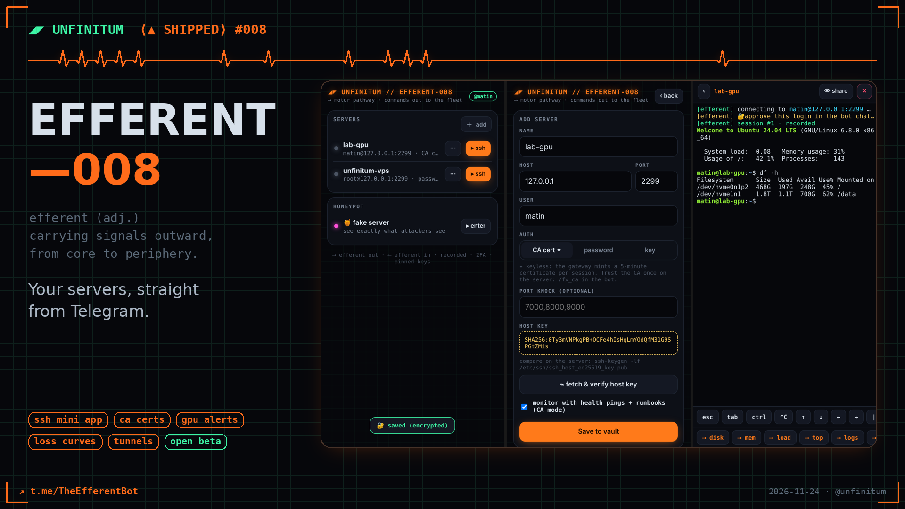
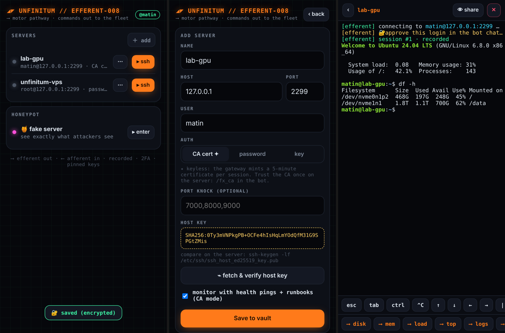

<p align="center">
  
</p>

<h1 align="center">EFFERENT-008</h1>

<p align="center">
  <b>Your servers, straight from Telegram.</b><br>
  <i>efferent (adj.) · carrying signals outward, from core to periphery.</i>
</p>

<p align="center">
  <a href="https://t.me/TheEfferentBot"></a>
  <a href="https://t.me/unfinitum"></a>
  
  
</p>

<p align="center"></p>

## ⟶ Try it

**Open [@TheEfferentBot](https://t.me/TheEfferentBot) in Telegram → `/start` → ⟶ OPEN TERMINAL.**
Open beta, free. Every user gets their own private fleet; nobody sees anyone else's servers.

## What it does

| | |
|---|---|
| ⟶ **Terminal Mini App** | Full xterm in Telegram. Server list + credentials encrypted **on your device** (PBKDF2-310k → AES-256-GCM); the gateway never stores them |
| 🔐 **Login approval** | Every new device confirms in the bot chat (allow once / trust 12h / deny) |
| 🪪 **Keyless logins** | Built-in SSH CA mints a 5-minute certificate per session. Trust it once with `/fx_ca` |
| 📌 **Pinned host keys** | Fingerprint verified before any credential is sent |
| ⟵ **Afferent health** | CPU · RAM · disk · GPU probes with charts and alerts when a node runs hot |
| ◉ **Training watch** | `/fx_watch` launches a job detached, pings you when it ends, plots the loss curve |
| 🚇 **Tunnels** | Jupyter / TensorBoard on your phone through an authenticated reverse proxy |
| ⚡ **Reflex arcs** | Alert fires → runbook runs (ask first or trusted) |
| 🎞 **Recordings** | Every session saved as asciinema cast + GIF, share live read-only |
| ⏳ **Time-boxed grants** | Give a collaborator access to one server for 2 hours |
| ♛ **CORTEX** | Owner panel: access mode, operators, live sessions + kick, bans, broadcast, lockdown |

<p align="center"></p>

## Self-host

```bash
git clone https://github.com/maasker/Efferent.git && cd Efferent
cp .env.example .env        # BOT_TOKEN, OWNER_ID, WEBAPP_URL …
./start_all.sh              # macOS: tunnel + bot in one command
# or on a Linux VPS:
docker compose up -d
```

The Mini App needs HTTPS: `start_all.sh` opens a Cloudflare quick tunnel automatically; on a server, point a domain at port 8088.

---

## Also inside: the NULLBYTE toolkit

EFFERENT-008 runs inside **NULLBYTE**, a security-lab bot of the UNFINITUM system. The same bot also ships:

A security-lab Telegram bot that talks like a terminal. Five modules:

| Module | What it does | Under the hood |
|---|---|---|
| 🕳 **Steganography** | Hide an encrypted message in a PNG or WAV; extract it with the passphrase | scrypt (N=2¹⁵) → AES-256-GCM, bits scattered across the carrier by a PCG64 stream seeded from HMAC(key) |
| 🧪 **Steganalysis** | "Is something hidden in this image?" | Westfeld–Pfitzmann χ² attack per channel, prefix curve, LSB-plane render, carving of bytes appended after PNG `IEND` / JPEG `EOI` |
| 🔬 **Metadata forensics** | What a photo leaks: GPS (as a map pin + address), device, serial numbers, lens, timestamps, embedded thumbnail; plus a scrubbed copy | EXIF IFD0 / ExifIFD / GPS IFD parsing, pixel-only re-encode |
| ⏳ **Time capsules** | Encrypt a message that *nobody* can open before a chosen date, including you and the bot | drand **tlock**: identity-based encryption to a future round on BLS12-381. The key is the League of Entropy's threshold signature for that round |
| 🧩 **Shamir secret sharing** | Split a secret into k-of-n shares; recover alone or in a group "ceremony" | GF(2⁸) polynomials (AES field), Lagrange interpolation, SHA-256 integrity check, CRC'd share strings |
| 🍯 **SSH honeypot** | A fake `prod-db-02` Ubuntu box that lets attackers in, records everything, and streams it to you | asyncssh server + fake shell. **Nothing is ever executed or downloaded.** Geo-IP, stats, replays, daily "Script Kiddie of the Day" |

---

## Quick start (Docker, recommended)

You need a small Linux VPS (any $4–6/month box works) where Telegram is reachable.

1. **Create the bot.** In Telegram, message **@BotFather** → `/newbot` → copy the token.
2. **Configure.**
   ```bash
   cp .env.example .env
   nano .env            # paste BOT_TOKEN
   ```
3. **Run.**
   ```bash
   docker compose up -d --build
   docker compose logs -f
   ```
4. **Make yourself the owner.** Open your bot, send `/id`, put the number in `.env` as `OWNER_ID`, then `docker compose up -d` again. The honeypot console and alerts are owner-only.
5. Send `/start`. 🎉

## Running without Docker

```bash
python3 -m venv .venv && source .venv/bin/activate
pip install -r requirements.txt
# time capsules need drand's tle CLI (Go 1.22+):
go install github.com/drand/tlock/cmd/tle@v1.2.0   # puts it in ~/go/bin
export PATH="$HOME/go/bin:$PATH"
set -a; source .env; set +a
python -m nullbyte
```

---

## Commands

```
/start          boot sequence + menu
/hide           bury a message in a PNG/WAV (send carrier as FILE)
/reveal         extract with passphrase
/detect         steganalysis report + LSB plane + carved tail
/exif           metadata dump, GPS pin, scrub button
/capsule [2h]   seal a time capsule (90s, 2h, 7d, 2w, 6M, 1y)
/capsules       your sealed capsules with countdowns
/unseal         open any .age capsule (paste or send file)
/split [3 5]    Shamir k-of-n split
/combine        paste shares to rebuild
/ceremony       start a group recovery ritual (secret goes to summoner only)
/contribute CODE share   guardians send this in DM
/hp             honeypot console          (owner)
/hp_stats 24h   threat intel: origins, creds, commands (24h|7d|30d|all)
/hp_live on     stream attacker keystrokes live
/hp_replay ID   transcript + ▶️ animated playback
/hp_kiddie      script kiddie of the day
/hp_stream on   live attacker feed → HP_STREAM_CHAT (masked, defanged)
/efferent       fleet dashboard + ⟶ terminal Mini App (alias /fx)
/fx_ca         CA public key + 3-line install snippet
/fx_grant S 2h [user=deploy] [ro]   one-time expiring access link
/fx_grants     active grants · revoke
/fx_cert ID PUBKEY   cert for your own SSH client (grantees)
/fx_signal S disk | /fx_signal add NAME CMD   runbooks
/fx_afferent S   probe + 24h chart
/fx_card S     secret-free connection card
/fx_knock S    port-knock from the gateway
/fx_sessions   recordings → GIF / .cast
/fx_watch S [cd=DIR] CMD   detached job + done ping + loss curve
/fx_jobs        jobs · progress · tail · kill
/fx_gpu [S]     GPU util / memory / temp
/fx_tunnel S PORT [name] [strip]   Jupyter/TensorBoard on your phone
/fx_tunnels     open tunnels · close
/fx_reflex S TRIGGER SIGNAL   auto-response to alerts  · /fx_reflexes
/fx_audit      audit log
/fx_breakglass 2 3  |  /fx_recover SHARES   Shamir over the CA key
/cancel  /id  /help
```

**Tip:** just send any image *as a file* (📎 → File) and the bot offers a menu: expose metadata, scan for stego, hide, reveal.

---

## 🍯 Honeypot setup (read this)

The honeypot listens on container port 2222. Scanners hit port **22**, so to catch real traffic:

1. **Move your real SSH first** (or you'll lock yourself out):
   ```bash
   sudo nano /etc/ssh/sshd_config      # set:  Port 52222
   sudo ufw allow 52222/tcp            # if you use ufw
   sudo systemctl restart ssh
   # open a NEW terminal and confirm:  ssh -p 52222 you@server
   ```
2. In `docker-compose.yml` change the port mapping to `"22:2222"` and run `docker compose up -d`.
3. Within minutes to hours you'll get `🍯 INTRUDER #1 IS IN` alerts. Bots try `root/123456` within minutes of a VPS going online.

**Safety model:** the fake shell answers from canned strings. No command runs, no file is written, `wget`/`curl` URLs are logged but never fetched. The container drops all capabilities and has a read-only filesystem. Still: run it on a disposable VPS, not on a machine with anything you care about, and don't "hack back". Check your provider's terms of service; most allow honeypots.

---

## ⟶ EFFERENT-008: SSH fleet control (an UNFINITUM subsystem)

*Efferent neurons carry commands from the central system out to the body. EFFERENT-008 carries yours out to your servers; health telemetry flows back in as* ***afferent*** *signals.*

A Mini App terminal (xterm.js) + server list + one-tap runbooks, backed by an SSH gateway in the bot.
Built so that **nothing secret is ever stored in plaintext or shared**.

| Feature | How it works |
|---|---|
| **Terminal** | `/efferent` → ⟶ open terminal. Full PTY, quick keys (esc/tab/ctrl/arrows) and ⚡ action chips (disk, mem, top, logs, ports, docker, restart nginx). |
| **Encrypted vault** | Your server list, passwords and keys are encrypted **on your device** (PBKDF2-SHA256 310k → AES-256-GCM) and synced via Telegram **CloudStorage**, so they follow you to every device. The bot only ever sees ciphertext at rest; credentials pass through gateway memory for one handshake. |
| **Keyless CA logins** ✦ | `/fx_ca` gives you 3 lines to paste on a server once. After that every session uses a fresh key + a **5-minute certificate**. No passwords, no `authorized_keys` sprawl. |
| **Host-key pinning** | Fingerprint is fetched and pinned when you add a server (TOFU). If it ever changes, the gateway aborts **before** sending any credential and shows a red warning. |
| **2FA** | Every new device must be approved in the bot chat (allow once / trust 12h / deny). |
| **Connection cards** 🪪 | Share host + port + user + pinned fingerprint (+ knock sequence). Zero secrets. Friends tap “add to my servers”. |
| **Grants** ⏳ | `/fx_grant lab 2h user=deploy [ro]` → one-time link. First person to open it gets access through the Mini App until it expires; `/fx_grants` to revoke (live sessions are cut instantly). Bring-your-own-key: `/fx_cert <id> <pubkey>` returns a cert that dies with the grant. |
| **Runbooks** | `/efferent` → ⚡ per server, or `/fx_signal lab disk`. Each runs with a cert whose **force-command is that exact command**. `/fx_signal add backup "sudo /opt/backup.sh"` for your own (always asks first). |
| **Health pings** 📈 | Monitored servers are probed every `OPS_HEALTH_MIN`; disk ≥90%, mem ≥92%, load/cpu ≥1.5, a recent reboot, or 2 failed probes → alert with a neon chart. One alert per state change, plus a “recovered” ping. |
| **Shared sessions** 👁 | In the terminal tap **share** → read-only live link for 1h. Watchers see the screen; their keystrokes are dropped. Great for teaching. |
| **Recordings** 🎞 | Every session is recorded (asciinema v2). `/fx_sessions` → ▶ animated GIF (idle gaps squashed) or the raw `.cast`. |
| **Break-glass** 🛡 | `/fx_breakglass 2 3` splits the CA private key into Shamir shares for 3 guardians; any 2 restore it with `/fx_recover`. |
| **Port knock** 🚪 | Give a server a knock sequence; the gateway knocks before every connect (and 🚪 in `/efferent`). `/fx_knock` prints a knockd config. |
| **Training watch** ◐ | `/fx_watch lab cd=~/odor python train.py --epochs 50` runs the job **detached** (own session, survives disconnects). When it ends you get exit code, duration, log tail and a **loss / accuracy curve** parsed from the log (`loss`, `val_loss`, `acc`, `f1`, `auc`, `epoch N/M`). `/fx_jobs` → 📈 progress · 📜 tail · ✕ kill (whole process group). |
| **GPU afferent** 🎛 | `nvidia-smi` rides along with every health probe: per-GPU util, memory, temperature. `/fx_gpu` for a live view, a GPU lane in the charts, alerts at ≥85 °C, and **"job running but GPUs idle"** after 10 min of <5% (stuck dataloader?). |
| **Tunnels** ⟶ | `/fx_tunnel lab 8888 jupyter` opens Jupyter / TensorBoard / any web UI on your phone at `/t/jupyter/`, over SSH direct-tcpip to the server's 127.0.0.1. No ports opened. Locked behind a signed, HttpOnly cookie minted only after Telegram auth (operators), 12 h lifetime. Start apps with a base path (`--ServerApp.base_url=/t/jupyter/`, `--path_prefix=/t/tb`) or add `strip`. |
| **Reflex arcs** ⚡ | `/fx_reflex lab disk clean`: when the stimulus (disk · mem · load · gpu · rebooted) hits, the response signal fires. Asks first; tap **always** to make it automatic. 30-min cooldown. `/fx_reflexes` to pause / trust / delete. |
| **Honeypot mode** 🍯 | The Mini App has a “fake server” entry: you see exactly what attackers see. `/hp_stream on` streams attacker commands live to `HP_STREAM_CHAT` (IPs masked, URLs defanged). |

### Setup
1. Telegram only opens Mini Apps over **HTTPS**. Pick one:
   - **Server**: put Caddy in front, e.g. `ops.example.com { reverse_proxy 127.0.0.1:8088 }` (Caddy handles certificates).
   - **Testing on your Mac**: `brew install cloudflared && cloudflared tunnel --url http://localhost:8088` and use the `https://…trycloudflare.com` URL it prints (it changes each run).
2. Set `WEBAPP_URL=https://…` in `.env` and restart. The bot sets its menu button to **⟶ efferent** for you.
3. `/fx_ca` → paste the snippet on your servers → in the Mini App: ＋ add → *CA cert* → fetch & verify host key → save.

### Threat model, honestly
* The gateway sees live session traffic: run it on a box you trust, keep `WEBAPP_HOST=127.0.0.1` behind the HTTPS proxy, and keep 2FA on.
* Every connection, grant, runbook, knock and recovery goes to the **audit log** (`/fx_audit`).
* The CA key is the crown jewel: set `OPS_CA_PASSPHRASE`, and do the break-glass split.
* Every WebSocket call is authenticated with Telegram's signed `initData` (HMAC-SHA256 with your bot token); guests can only reach servers they hold a live grant for.

## How the crypto actually works

**Stego format.** The first 128 LSBs hold a random salt. `key = scrypt(pass, salt)`. The body `[len][nonce][AES-GCM ciphertext]` is written into LSB positions chosen by a PRNG seeded from `HMAC(key, "scatter")`, so without the passphrase the payload is spread noise with no header to find. A wrong passphrase and a clean image are indistinguishable by design (GCM tag fails either way). At most 25% of the LSBs are ever used, which keeps χ² quiet. Output is always lossless PNG/WAV: **send it as a file**, because any recompression (Telegram "photo", WhatsApp, Instagram) destroys the payload.

**Detection limits.** χ² catches sequential or heavy LSB replacement (the classic tools). Light, scattered, encrypted payloads like NULLBYTE's own are designed to slip under it. Smooth or saturated images can give false positives.

**Time capsules.** `tle` encrypts to drand quicknet round *r* (one round every 3 s). Decryption needs the BLS signature for round *r*, which the drand network's threshold of independent operators only publishes when *r* arrives. The bot stores only ciphertext and also sends you the `.age` file, so you can open it with `tle -d` on any machine even if the bot is gone. Your plaintext message is deleted from the chat after sealing (it does pass through Telegram and the bot's memory once).

**Shamir.** Each byte of `secret || sha256(secret)[:4]` gets its own random polynomial of degree k−1 over GF(2⁸); share *x* is the evaluations at *x*. Any k shares interpolate f(0); k−1 shares are information-theoretically useless. Share format: `sss1-<set>-<k>-<x>-<base32>-<crc16>`.

---

## Tests

```bash
pip install -r requirements-dev.txt
python -m pytest -q
```

`tests/test_bot_flows.py` drives every handler end to end against a mock Telegram API (hide → reveal, detection, EXIF + scrub, capsule seal → unseal, split → combine, group ceremony, and a real SSH session against the honeypot). It uses a fake `tle` in `tests/fakebin/` so it runs offline. The real one is used in production.

## Layout

```
nullbyte/
  bot.py          Telegram handlers, flows, styling, jobs
  stego.py        embed / extract / χ² analysis / EOF carving
  exif_tools.py   metadata forensics + scrubber
  capsule.py      drand tlock wrapper
  shamir.py       GF(2^8) secret sharing
  honeypot.py     asyncssh fake server + fake shell
  db.py  ui.py  config.py
```

Use responsibly: hide your own secrets, analyse files you're allowed to analyse, and trap only the bots that come knocking on your own server.

### ♛ CORTEX — owner controls (no .env edits, no restart)
| command | what |
|---|---|
| `/fx_admin` | control panel: access mode, operators, live sessions, lockdown |
| `/fx_allow ID\|@user [30m\|12h\|7d\|2w\|forever]` | make someone an operator (or reply to a forwarded message) |
| `/fx_revoke ID` | remove operator + close their sessions/tunnels |
| `/fx_ban` · `/fx_unban ID` | block from the whole bot |
| `/fx_mode open\|private` | open EFFERENT to everyone (each user gets their own fleet) |
| `/fx_live` · `/fx_kick ID` | who's connected right now, kick them |
| `/fx_users` · `/fx_whois ID` | user directory with roles |
| `/fx_broadcast text` | message every user (preview + confirm) |
| `/fx_lockdown [off]` | panic: kill non-owner sessions, revoke grants, freeze operators |

Guests who hit `/efferent` get a **📨 Request access** button; you get a card with ✓ 24h / ✓ 7d / ✓ forever / ✕ / ⛔.
